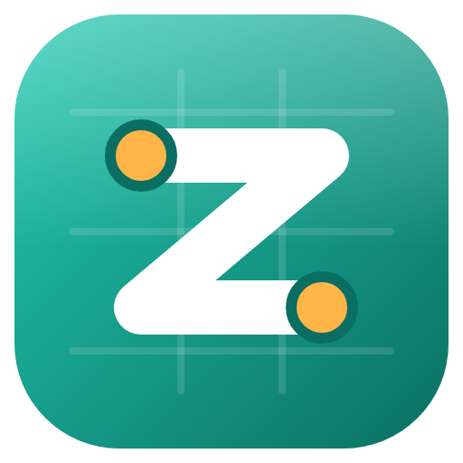
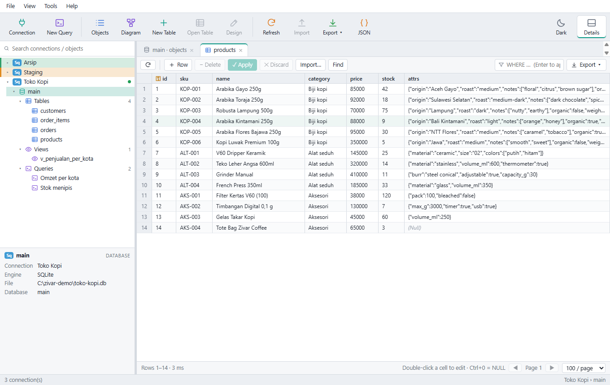

<div align="center">



# Zivar Database Studio

**Aplikasi desktop untuk mengelola database PostgreSQL, MySQL / MariaDB, SQL Server, dan SQLite.**

Jelajahi, query, edit, rancang, pindahkan, dan gambarkan database dari satu jendela.

[Unduh](https://github.com/ravizulfikar/zivar-studio/releases/latest) · [Website](https://zivar.my.id) · [English](README.md)



</div>

## Fitur

- **Koneksi**: PostgreSQL, MySQL / MariaDB, SQL Server, dan SQLite. Bisa dikelompokkan dalam folder, diberi warna (tandai server produksi), memakai SSL/TLS, dan SSH tunnel (password atau private key). Password disimpan terenkripsi dengan penyimpanan aman sistem operasi.
- **Pohon objek**: database / schema → tabel, view, materialized view, fungsi, dan query tersimpan. Ada kotak cari, menu klik kanan, dan panel detail.
- **Grid data**: paging, pengurutan, filter `WHERE`, dan pengeditan yang aman. Perubahan ditampung dulu, lalu ditulis dalam satu transaksi lewat **Apply**. Ada cari & ganti antar sel dan penampil sel (teks, JSON, hex, gambar).
- **Editor SQL**: autocomplete yang mengenal skema, jalankan bagian terpilih (`Ctrl+Enter`), stop, explain, beautify / minify, snippets (bawaan dan milik Anda), riwayat query, dan query tersimpan per database.
- **Editor JSON**: teks dan pohon berdampingan. Bisa cari, edit di pohon, format, minify, dan urutkan key. Angka besar dan urutan key tetap persis.
- **Desain tabel**: kolom, indeks, dan foreign key dengan **pratinjau DDL**. Diterapkan dalam transaksi di database yang mendukung DDL transaksional.
- **Impor / ekspor**: impor CSV, TSV, Excel, dan JSON / NDJSON dengan pemetaan kolom. Ekspor ke Excel, CSV, JSON, atau SQL `INSERT`.
- **Migrasi**: jalankan berkas `.sql`, dump ke SQL, **transfer data antar koneksi (bahkan antar jenis database)**, dan sinkronisasi struktur tabel.
- **ER diagram**: diagram tabel dan relasi yang bisa digeser dan di-zoom, dengan ekspor SVG / PNG.
- **Lainnya**: tema terang dan gelap, dokumentasi bawaan yang bisa dicari (`F1`, berbahasa Indonesia), dan versi portable yang tidak perlu instalasi.

## Unduh

Ambil versi terbaru di halaman [**Releases**](https://github.com/ravizulfikar/zivar-studio/releases/latest):

| Platform | Berkas | Cara memasang |
|---|---|---|
| **Windows 10 / 11** (x64) | `ZivarDatabaseStudio-Setup-<versi>.exe` | Jalankan (instalasi per pengguna, folder bisa dipilih). |
| | `ZivarDatabaseStudio-Portable-<versi>.exe` | Satu berkas, langsung jalan tanpa instalasi. |
| **Debian / Ubuntu** (x64) | `ZivarDatabaseStudio-<versi>-linux-amd64.deb` | `sudo apt install ./ZivarDatabaseStudio-<versi>-linux-amd64.deb` |
| **Fedora / openSUSE / RHEL** (x64) | `ZivarDatabaseStudio-<versi>-linux-x86_64.rpm` | `sudo dnf install ./ZivarDatabaseStudio-<versi>-linux-x86_64.rpm` |
| **Linux apa pun** (x64) | `ZivarDatabaseStudio-<versi>-linux-x86_64.AppImage` | `chmod +x` lalu jalankan. |
| | `SHA256SUMS.txt` | Checksum untuk memeriksa keaslian unduhan. |

Installer Windows belum ditandatangani (code signing), jadi SmartScreen mungkin menampilkan peringatan pada pembukaan pertama. Pilih *More info → Run anyway* jika Anda mempercayai sumbernya.

### Catatan untuk Linux

- **Password butuh keyring.** Password koneksi disimpan di keyring sistem (gnome-keyring atau KWallet lewat libsecret). Kebanyakan distribusi desktop sudah punya; di sistem minimal, pasang `gnome-keyring` dan login ke keyring itu. Tanpa keyring, aplikasi menolak menyimpan password daripada menyimpannya sebagai teks biasa.
- **AppImage** membutuhkan FUSE 2: `sudo apt install libfuse2` (`libfuse2t64` di Ubuntu 24.04), atau jalankan dengan `--appimage-extract-and-run`.
- **Ubuntu 24.04 ke atas** membatasi user namespace yang dipakai sandbox Chromium, sehingga *AppImage* bisa gagal berjalan ("The SUID sandbox helper binary was found, but is not configured correctly"). Paket `.deb` dan `.rpm` memasang sandbox dengan benar dan tidak terkena masalah ini, jadi pilih keduanya di sana. Jika tetap ingin AppImage, izinkan namespace itu lewat profil AppArmor atau jalankan dengan `--no-sandbox`; aplikasi hanya memuat halamannya sendiri, tetapi opsi ini mematikan satu lapisan perlindungan.

## Membangun dari kode sumber

Syarat: [Node.js](https://nodejs.org) 22 atau lebih baru, dan Git.

```bash
git clone https://github.com/ravizulfikar/zivar-studio.git
cd zivar-studio
npm ci

npm run dev          # jalankan untuk pengembangan
npm run typecheck    # pemeriksaan TypeScript
npm test             # tes unit dan integrasi
npm run dist         # Windows: buat installer dan exe portable di ./release
npm run dist:linux   # Linux: buat AppImage, .deb, dan .rpm di ./release (jalankan di Linux)
```

Detail tes, skrip lain, struktur proyek, dan batasan yang diketahui ada di [README berbahasa Inggris](README.md).

## Merilis versi baru

Rilis dibuat otomatis oleh GitHub Actions ([`release.yml`](.github/workflows/release.yml)):

1. Ubah `version` di `package.json` (dan `package-lock.json`, misalnya `npm version <x.y.z> --no-git-tag-version`), lalu commit.
2. Beri tag dan push: `git tag v1.0.0 && git push origin v1.0.0`.
3. Workflow menjalankan typecheck dan tes di kedua platform, membangun installer dan exe portable Windows serta AppImage, `.deb`, dan `.rpm` Linux, membuka tiap aplikasi hasil paket sekali sebagai tes asap, membuat GitHub Release dengan catatan otomatis, lalu melampirkan semua berkas beserta checksum-nya.

Workflow menolak menerbitkan jika tag tidak sama dengan versi di `package.json`. Tag bersufiks (`v1.1.0-beta.1`) diterbitkan sebagai pra-rilis.

## Lisensi

[MIT](LICENSE) © 2026 Zivar. Komponen pihak ketiga memakai lisensinya masing-masing.
