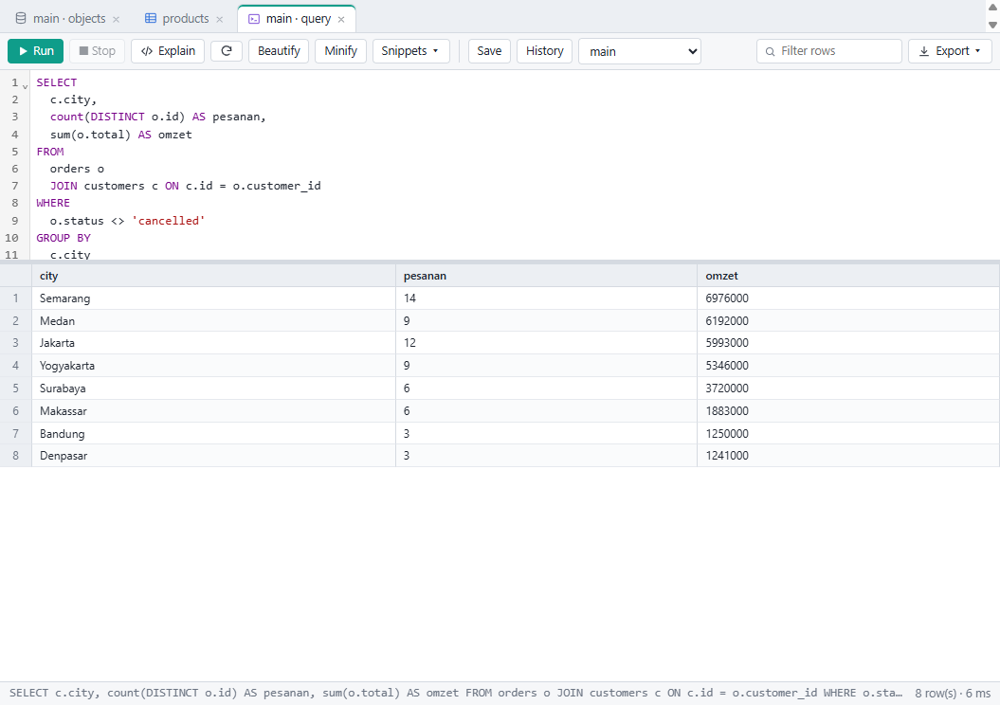
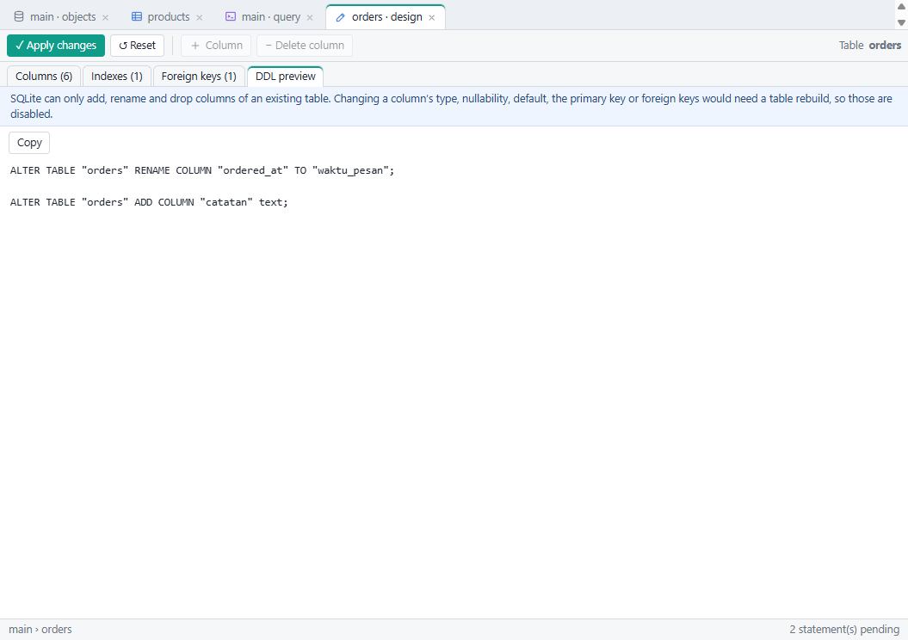
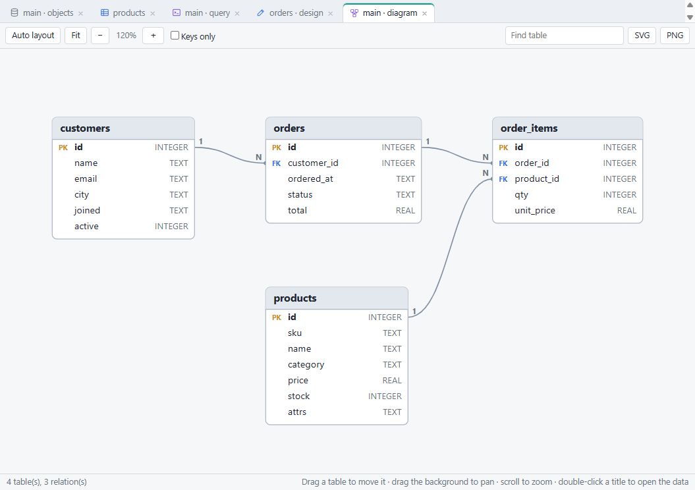
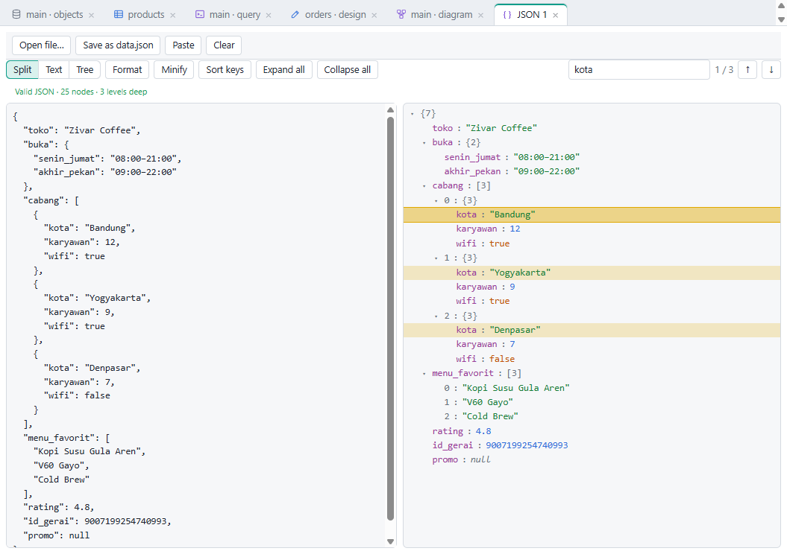
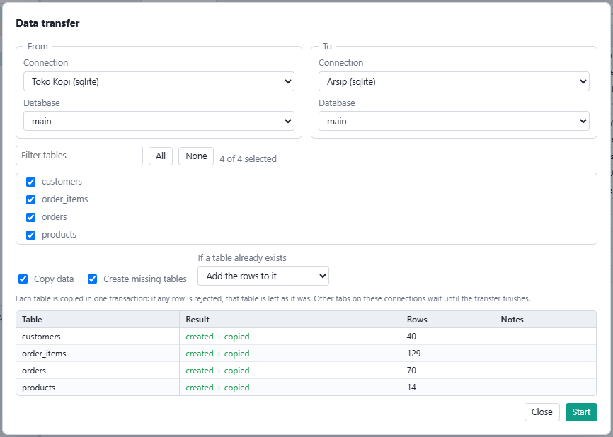
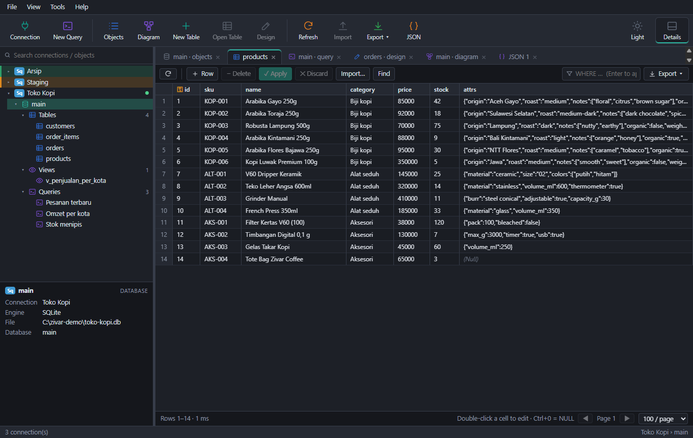

<div align="center">


# Zivar Database Studio

**A desktop database client for PostgreSQL, MySQL / MariaDB, SQL Server and SQLite.**

Browse, query, edit, design, migrate and diagram your databases from one window.

[](https://github.com/ravizulfikar/zivar-studio/actions/workflows/ci.yml)
[](https://github.com/ravizulfikar/zivar-studio/releases/latest)
[](LICENSE)

[Download](https://github.com/ravizulfikar/zivar-studio/releases/latest) · [Website](https://zivar.my.id) · [Bahasa Indonesia](README.id.md)


</div>

## Features

| | |
|---|---|
| **Connections** | PostgreSQL, MySQL / MariaDB, SQL Server and SQLite. Folders and colour tags (mark production at a glance), SSL/TLS, and SSH tunnels with password or private key. Passwords are encrypted with the operating system's secure storage. |
| **Object tree** | Databases / schemas → tables, views, materialized views, functions and your saved queries. Filter box, context menus, and a details panel. |
| **Data grid** | Paging, sorting, `WHERE` filter, and safe editing: changes are staged, then written in one transaction with **Apply**. Find & replace across cells, and a cell viewer for text, JSON, hex and images. |
| **SQL editor** | Schema-aware autocomplete, run selection (`Ctrl+Enter`), stop, explain, beautify / minify, snippets (built-in and your own), query history and per-database saved queries. |
| **JSON editor** | Text and tree side by side: search, edit in the tree, format, minify, sort keys. Exact big numbers and key order are preserved. |
| **Table designer** | Columns, indexes and foreign keys with a live **DDL preview**; applied in a transaction wherever the database supports transactional DDL. |
| **Import / export** | Import CSV, TSV, Excel and JSON / NDJSON with column mapping. Export to Excel, CSV, JSON or SQL `INSERT`. |
| **Migration** | Run `.sql` files (understands `$$`, `DELIMITER`, `GO`), dump to SQL, **transfer data between connections — even across engines** — and synchronise table structure. |
| **ER diagram** | Draggable, zoomable diagram of your tables and relations, with SVG / PNG export. |
| **And** | Light and dark themes, a built-in searchable manual (`F1`, in Indonesian), and a portable build that needs no installation. |

<details>
<summary>More screenshots</summary>

| | |
|---|---|
|  |  |
|  |  |
|  |  |

</details>

## Download

Get the latest build from the [**Releases**](https://github.com/ravizulfikar/zivar-studio/releases/latest) page:

| Platform | File | How to install |
|---|---|---|
| **Windows 10 / 11** (x64) | `ZivarDatabaseStudio-Setup-<version>.exe` | Run it (per-user install, you can choose the folder). |
| | `ZivarDatabaseStudio-Portable-<version>.exe` | A single file; run it anywhere, no installation. |
| **Debian 12 / 13, Ubuntu 22.04 / 24.04** (x64, installed and started in CI) | `ZivarDatabaseStudio-<version>-linux-amd64.deb` | `sudo apt install ./ZivarDatabaseStudio-<version>-linux-amd64.deb` |
| **Fedora** (x64, installed and started in CI) and compatible | `ZivarDatabaseStudio-<version>-linux-x86_64.rpm` | `sudo dnf install ./ZivarDatabaseStudio-<version>-linux-x86_64.rpm` |
| **Any Linux** (x64) | `ZivarDatabaseStudio-<version>-linux-x86_64.AppImage` | `chmod +x` the file and run it. |
| | `SHA256SUMS.txt` | Checksums to verify the downloads. |

The Windows installers are not code-signed, so SmartScreen may show a warning the first time; choose *More info → Run anyway* if you trust the source.

### Linux notes

- **Passwords need a keyring.** Connection passwords are stored in the system keyring (gnome-keyring or KWallet through libsecret). Most desktop distributions have one; on a minimal system install `gnome-keyring` and sign in to it. Without a keyring the app refuses to save a password rather than store it as plain text.
- **AppImage** needs FUSE 2: `sudo apt install libfuse2` (`libfuse2t64` on Ubuntu 24.04), or run it with `--appimage-extract-and-run`.
- **Ubuntu 24.04 and newer** restrict the unprivileged user namespaces that Chromium's sandbox uses, which can stop an *AppImage* from starting ("The SUID sandbox helper binary was found, but is not configured correctly"). The `.deb` and `.rpm` packages install the sandbox helper properly and are not affected, so prefer them there. If you do want the AppImage, either allow the namespaces for it (an AppArmor profile) or start it with `--no-sandbox`; the app only loads its own local pages, but this does switch a layer of protection off.

## Build from source

Requirements: [Node.js](https://nodejs.org) 22 or newer, and Git.

```bash
git clone https://github.com/ravizulfikar/zivar-studio.git
cd zivar-studio
npm ci

npm run dev          # run in development with hot reload
npm run typecheck    # TypeScript
npm test             # unit and integration tests
npm run dist         # Windows: build the installer and the portable exe into ./release
npm run dist:linux   # Linux: build the AppImage, .deb and .rpm into ./release (run it on Linux)
```

Other scripts:

| Script | What it does |
|---|---|
| `npm run test:ui` | Also drives the real app end to end over the DevTools protocol (build first: `npx electron-vite build`). |
| `npm run docs:shots` | Regenerates the screenshots used in the built-in manual from a demo database. |
| `npm run icon` | Renders `resources/icon.svg` into `build/icon.ico` and the PNGs. |

### Tests

`npm test` runs the pure logic suites and the SQLite integration tests. When PostgreSQL or MySQL binaries are available it also starts **throwaway servers of its own** (on free ports, in temporary folders, never touching your configuration) and runs the same suites against them; otherwise those suites are skipped. Set `ZIVAR_TEST_SKIP_SERVERS=1` to skip them explicitly. To run against a server you provide, set `ZIVAR_TEST_PG_URL` / `ZIVAR_TEST_MYSQL_URL` to a **scratch** database.

## Releasing

Releases are built and published by GitHub Actions ([`release.yml`](.github/workflows/release.yml)).

1. Set `version` in `package.json` (and in `package-lock.json`, e.g. with `npm version <x.y.z> --no-git-tag-version`) and commit.
2. Tag and push: `git tag v1.0.0 && git push origin v1.0.0`.
3. The workflow type-checks and tests on both platforms, builds the Windows installer and portable exe and the Linux AppImage, `.deb` and `.rpm`, starts each packaged app once as a smoke test, creates the GitHub Release with generated notes, and attaches all files with their checksums.

The workflow refuses to publish if the tag does not match `package.json`. A tag with a suffix (`v1.1.0-beta.1`) is published as a pre-release. You can also run the workflow manually from the *Actions* tab to get the installers as downloadable artifacts without creating a release.

## Project layout

```
src/main       Electron main process: IPC, database drivers (pg, mysql2, mssql, SQLite), SSH tunnel, dump / transfer
src/preload    The narrow API exposed to the UI
src/renderer   The React UI (tabs, dialogs, editors) and the in-app manual
src/shared     Pure, unit-tested logic: DDL planning, schema sync, type conversion, SQL splitting, ER layout, JSON model
tests          Unit, integration and end-to-end suites
scripts        Screenshot and icon generators
```

## Known limitations

- **SQL Server** support is implemented but has not been exercised against a real server.
- **Linux** builds are checked in CI (they build, start and render the manual under a virtual display) but have had less hands-on use than the Windows ones.
- **SQLite** cannot cancel a running query, and cannot change column types, the primary key or foreign keys of an existing table.
- **MySQL** DDL is not transactional, so a failed schema change can be partially applied.
- **Dump SQL** covers tables only (not views, functions or triggers); **structure synchronisation** works between databases of the same engine.
- Not included: scheduling, automatic backups, charts / BI, database user management.

## Security

- Passwords (including SSH passwords and key passphrases) are stored encrypted with the OS secure storage (DPAPI on Windows), never as plain text.
- SSH host keys are pinned on first connection; a changed key is refused.
- The app makes no network connections other than the database connections you configure.

Found a vulnerability? Please open a private [security advisory](https://github.com/ravizulfikar/zivar-studio/security/advisories/new) rather than a public issue.

## License

[MIT](LICENSE) © 2026 Zivar. Third-party components keep their own licenses.
